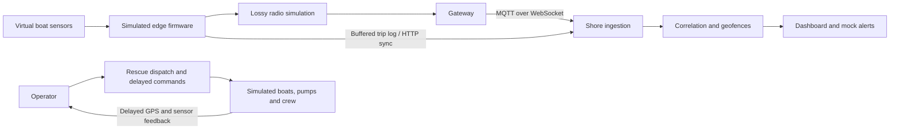

# SeaGuard — maritime IoT safety and rescue exercise

SeaGuard is an educational, locally running Node-RED application that simulates a fishing fleet, unreliable radio telemetry, shore-side emergency detection and operator-led rescue missions. It demonstrates the complete path from a virtual sensor to an incident, a resource decision, a delayed command and sensor-confirmed recovery.

**Demo release: 2026-10-24, Windows x64.** The portable ZIP includes Node.js and application dependencies. No Unsloth, AI model, cloud account, API credits or hardware is required. Core simulation, weather and message delivery work locally. Geographical map tiles need internet access.

This is a simulation for demonstration and review. Boat/crew names, GPS tracks, boundaries, emergencies and rescue parameters are illustrative. It is not a navigation aid, operational emergency service or validated hardware safety system.

## 1. Start on a new computer

1. Download the **portable Windows ZIP** from the GitHub release. The GitHub **Source code ZIP** is a separate developer download and does not include the runtime/dependencies.
2. Extract the entire portable ZIP into a writable folder, for example `Documents/SeaGuard-Demo`. Do not run it inside the ZIP or under Program Files. Keep the folder structure together.
3. Double-click **START.cmd**. It builds the flow, starts Node-RED hidden, checks readiness and opens the dashboard. First start may take about 30 seconds.
4. Open `http://127.0.0.1:1880/dashboard` if the browser does not open. Use the dashboard menu to change pages.
5. Use **STOP.cmd** when finished. Closing the browser alone leaves the server running. Run START.cmd again to return later.
6. **VERIFY.cmd** runs offline regression checks; it does not need a running server. Console output and `seaguard/reports` contain the evidence.

Requirements: Windows 10/11 x64, a modern browser, a writable extracted folder and port 1880 available. There is no LAN listener or Windows service/autostart installation. START/STOP identify this demo's process using its settings-file path; a busy port is reported rather than killing another application. Do not run the demo alongside another SeaGuard instance on the same port.

## 2. What you can demonstrate now

| Area | Working behaviour in this release |
|---|---|
| Fleet | Five simulated fishing vessels with position, speed, roll, bilge, crew-tag visibility, battery and radio freshness |
| Geographical chart | OpenStreetMap-based fleet chart with illustrative harbour, reserve/boundary and vessel reports |
| Radio/network | Simulated radio loss, delay, duplication and outages; real local MQTT messaging between gateway and shore logic |
| Detection | Debounced capsize/flooding, missing crew tags, communication loss, boundary/reserve warnings and weather context |
| Incidents | Correlation, severity, acknowledgement, escalation and operator visibility |
| Alerts | Local mock delivery, retry/timeouts, delivery history and pending-message retention; no real messages |
| Trip records | Onboard buffering, harbour Wi-Fi sync simulation, sequence acknowledgements and duplicate-safe ingestion |
| Test lab | Repeatable seeded fault campaigns with injected-event history and automated assertions |
| Rescue | Four guided scenarios, dispatch/manpower, reinforcement, finite boats/personnel/one shared recovery kit, travel and return |
| Response | Pump start/stop, hull repair, radio repair, return to safe water, command stages and delayed sensor confirmation |
| Battery | Finite pump energy, low/depleted warnings, actual pump shutdown and a delayed harbour battery replacement |
| Rescue history | Event/command timeline, response metrics and all-clear only after safety conditions and team return |
| Rescue durability | Save/load, automatic checkpoints, previous-good backup, validation and paused restore after restart |

The fleet simulation and rescue exercise are **two independent clocks/worlds**. A fleet campaign does not automatically create a mission in the rescue exercise. This separation makes demonstrations repeatable; integrating the two is future work.

## 3. Dashboard tour

Use the navigation menu; direct page names include `/dashboard/fleet`, `/dashboard/testlab` and `/dashboard/rescue`.

- **Fleet:** quick situational overview; compare last shore report with simulator truth, radio age and actual vessel condition. Pause, resume, change speed or restart the fleet world.
- **Chart:** geographical positions and illustrative safety areas. A received fix is not guaranteed to be the latest physical position.
- **Radio and network:** see the link and gateway behaviour behind missing or delayed reports.
- **Incidents:** inspect/correlate dangers and acknowledge them. Acknowledgement records an operator response; it does not physically fix flooding or rescue a person.
- **Sea state:** local simulated weather context and advisories.
- **Alerts:** inspect mock delivery, attempts, failures and retries; send a local test message.
- **Test lab:** select a seed and speed, run the fault campaign and inspect assertions/injections.
- **How it works:** explanatory view of the system.
- **Rescue exercise:** interactive response controls, team/equipment status, geographical rescue map, timeline and results.

The map/control templates compile successfully. **Final visual acceptance is outstanding:** automated browser permission prevented inspecting the rendered SeaGuard pages during this release. API and model tests do not establish visual correctness. Check the map layout, markers, button accessibility and mobile sizing on the demo PC before presenting.

## 4. Full review demonstration (20–30 minutes)

### A. Explain the system (2 minutes)

Start on Fleet. Say: “These are simulated boats. The shore receives imperfect reports, so the dashboard distinguishes what shore knows from what is actually happening.” Point out roll, bilge, crew count, battery, radio age and received GPS. Explain that background packet loss can create small differences without automatically meaning an emergency.

Open Chart. Show the harbour and safety areas. Zoom/pan and explain the boundary is illustrative. If tiles are unavailable, do not claim the geographical basemap is offline; continue using displayed coordinates and status panels.

### B. Run a repeatable fleet campaign (3–5 minutes)

1. Open Test lab. Enter seed **0** and choose an accelerated speed (20x or 30x where offered). Start the campaign.
2. Read the injected-event list while switching to Fleet and Incidents. Expect staged failures rather than every boat failing immediately.
3. Acknowledge an incident and explain why the dangerous sensor condition remains visible.
4. Open Radio/network to relate lost reports to link/gateway faults. Compare shore fixes with simulator truth.
5. Open Alerts to show local mock delivery and retry history. Nothing is sent to a real family or emergency service.
6. Return to Test lab after completion. The campaign lasts **360 simulated seconds plus a 20-second drain window**, then pauses for inspection. Review PASS/FAIL and any not-exercised results honestly.
7. Explain the harbour boat's buffered trip-record upload: batches and acknowledgements complete during the drain window. Duplicate uploads must not create duplicate records.

Seed zero is valid. A second campaign request while one is running is rejected, preserving the active run. Seeds control fault choices; real scheduling can still affect observed delivery order. Restart the simulation when a fresh world is wanted.

### C. Flooding rescue with meaningful actions (5 minutes)

1. Open Rescue exercise; Reset if an old exercise is loaded. Select **Flooding**, Start and initially use 1x/5x to explain controls, then 20x to shorten travel.
2. Choose **T2**, assign **6 crew** and tick **recovery kit**, then Dispatch. Watch resources become committed and status change EN_ROUTE → ON_SCENE. Do not dispatch the same boat twice.
3. Acknowledge when appropriate. Once on scene, issue **START_PUMP** and **REPAIR**. Observe command sent/received/executed/confirmed stages and water changing over simulated time.
4. Explain that the pump removes water, while hull repair stops ingress after work time. A command acknowledgement alone is insufficient evidence that the vessel is safe.
5. Wait for crew safety, safe water and delayed sensor confirmation. The incident can resolve while a team remains on scene; the exercise is not yet all-clear.
6. Issue **RETURN**. Wait until the team reaches harbour and its resources are released. The exercise becomes green/all-clear and automatically pauses.
7. Review the timeline and computed results. Distinguish simulated seconds from wall-clock seconds at accelerated speed.

To show reinforcement, start a fresh flooding exercise with a smaller response, observe insufficient progress, then assign the second available team using Reinforce. Equipment/personnel availability limits remain enforced; the shared recovery kit cannot be booked twice. Do not promise a response succeeds merely because a button was pressed.

### D. Other scenarios (4–6 minutes)

Reset between each scenario. T2 with six crew and the recovery kit is the validated straightforward response. Always wait for arrival, acknowledge, perform the scenario action and return the team home.

| Scenario | Operator action and lesson |
|---|---|
| Man overboard | Dispatch with recovery equipment. On-scene recovery and sensor confirmation take time; recovery equipment is finite. Return home for all-clear. |
| Radio failure | Dispatch, then use **RADIO_REPAIR** on scene. Repair takes 90 simulated seconds; queued sensor reports arrive after connectivity returns. A missing report does not prove safety. |
| Boundary approach | Use **RETURN_TO_SAFE_WATER** when applicable; allow the 60-second return manoeuvre and confirmation. The safety condition must truly clear. |

### E. Battery limits and faults (3 minutes)

Each default rescue pump has a **20 Wh** battery and draws **120 W** when operating: `energy used = watts × seconds / 3600`. A continuously running full battery lasts 600 simulated seconds. Travel, stopped pumps and pump faults do not drain pump energy. Partial final seconds remove only the water the remaining energy can support.

During a fresh flooding run start the pump before completing repair; inspect charge/runtime status and low warnings. A longer on-scene pumping interval can demonstrate depletion (about 30 real seconds of pumping at 20x). Do not return the team before the demonstration if you want to observe depletion. Fault controls allow an actual pump failure; a repaired pump needs a new start command. Empty-battery start is rejected at execution.

Return the team home and choose **Replace battery**. This is a simulated **60-second battery replacement**, not a scientifically modelled electrical charger. It does not refill instantly on arrival. Dispatch is unavailable while replacement is in progress. On a completed exercise, replacement resumes its clock for the operation and pauses again afterwards.

### F. Save, stop and resume a mission (3 minutes)

1. Start a fresh mission and dispatch a team. Pause while it is travelling; click **Save checkpoint** and check that save succeeded.
2. Run STOP.cmd, then START.cmd. Open Rescue exercise.
3. The saved rescue mission loads **paused**, retaining operational state and pending work. Explain that an operator must choose Resume; downtime must not silently advance the mission.
4. Resume and finish the response. Load checkpoint deliberately replaces the current rescue exercise with the most recent saved version; it is not an undo-history browser.

The store keeps a previous-good backup and reports recovery/write errors. Never demonstrate corrupt-file recovery by damaging the only presentation copy; automated tests cover this. **Fleet incidents, trips and pending alerts are still memory-backed and reset on restart. Rescue persistence does not make the fleet durable.**

## 5. Architecture and IoT technologies

| Technology/protocol | Actual implementation and purpose |
|---|---|
| Node.js + Node-RED | Local event-driven runtime; flow wiring joins sensors, gateway, shore logic, APIs and dashboard |
| FlowFuse Dashboard / Vue | Interactive dashboard templates and controls using the local Node-RED dashboard connection |
| MQTT / WebSocket | Aedes embedded broker, path `/seaguard-mqtt`, sharing the loopback HTTP listener; gateway uplink/downlink topics such as `seaguard/up/<boat>` and `seaguard/down/<boat>` |
| JSON application messages | Vessel identity, sequence numbers, sensor values, events, sample times and acknowledgements |
| HTTP / JSON | Local REST-style control/state endpoints, batched trip sync at `/seaguard/sync`, local weather and notification mocks |
| Geographic tracking | Simulated latitude/longitude and delayed received GPS; geographical worldmap/OpenStreetMap presentation |
| Edge detection | Sustained-threshold debounce, latched events and tag-loss timing before transmitting critical events |
| Store and forward | Boat log buffering; batch upload when harbour Wi-Fi is simulated available; contiguous acknowledgements and duplicate-safe ingestion |
| Fault tolerance | Sequence checks, event acknowledgements/backoff, correlation windows, bounded caches, timeouts and outbox retention |
| Local persistence | Validated rescue JSON checkpoint, atomic replacement, previous-good backup and paused recovery |

**What is simulated:** LoRa-like range/loss/delay, crew tags, GNSS fixes, roll/bilge/battery sensors, boats, weather, physical pumps, fuel, harbour Wi-Fi availability and emergencies. This is **not an implemented LoRaWAN network**, BLE deployment, real GNSS receiver or hardware sensor integration. MQTT, the HTTP server, dashboard and file persistence are real software services on the PC. Application acknowledgements and idempotence are needed even where transport delivers messages; transport delivery is not proof of physical execution.

Edge examples: capsize uses sustained roll rather than one wave spike; flooding needs sustained high water; tag absence must persist before a missing-crew event. Shore correlation reduces duplicate incidents, geofence hysteresis avoids rapid border chatter, and reported sample times distinguish old data from current conditions. Thresholds and physical coefficients are illustrative configuration, not field-calibrated engineering limits.

## 6. Reliability and evidence

`VERIFY.cmd` runs battery arithmetic/integration, dispatch/model, controller, rescue persistence/recovery, review regressions, fleet API logic/outbox and Vue syntax checks. Reports live in `seaguard/reports`. Live validation additionally runs real Node-RED HTTP/MQTT campaigns and four rescue workflows. See **RELEASE-VERIFICATION.md** for exact release results and unexercised checks. A passing syntax test is not a rendered UI inspection, and a simulated campaign does not establish hardware readiness.

Safety/reliability properties demonstrated include: no double booking, no resource release before return, finite energy, bounded input validation, duplicate-safe trip records, old GPS rejection, no alert eviction merely because terminal history is full, corrupt-primary recovery without destroying a valid backup, and explicit paused restart.

## 7. Source layout and developer setup

| Path | Purpose |
|---|---|
| `seaguard/flow.base.json` | Flow wiring/configuration |
| `seaguard/src/functions/*.js` | Readable Node-RED function sources |
| `seaguard/src/dashboard/*.vue` | Dashboard sources |
| `seaguard/src/rescue/*.cjs` | Standalone rescue model, controller, battery and persistence |
| `seaguard/build.mjs` | Validates IDs/wires and generates `flows.json` |
| `seaguard/tests` | Regression and live API tests |
| `launch.mjs`, `START.cmd`, `STOP.cmd` | Portable lifecycle controls |
| `runtime`, `node_modules`, `userdir/node_modules` | Bundled runtime/dependencies in portable ZIP only |
| `seaguard/data`, `logs` | Local generated checkpoints and logs; not published |

Edit sources, then run `node seaguard/build.mjs`; do not edit generated flows independently. Node-RED editor changes must be deliberately ported back before the next build. The demo is a frozen release: assistance/relay code paths are disabled and their unfinished dashboard controls are excluded.

For a **source checkout**, install a supported Node.js runtime, run `npm install` in the root and `npm install --prefix userdir`, then `npm test`. Run `node launch.mjs` to start on Windows. The prebuilt portable ZIP avoids these installs. Runtime versions used for the freeze: Node.js 24.22.1, Node-RED 4.1.16, FlowFuse Dashboard 1.34.0, Aedes node 1.4.0 and worldmap 5.9.1; `DEPENDENCIES.json` inventories bundled packages. Keep their original license files. `runtime/NODE-LICENSE.txt` contains the matching Node.js notices. No new license grant for the project source is implied by public hosting.

## 8. Limitations and next sprint

- Nearby-vessel assistance and radio relay: development work exists but is deliberately disabled in this release pending review and integration tests.
- Fleet durability: persist incidents, trip history and pending alerts across restarts without duplicating confirmed deliveries.
- Results completion: explicitly measure missed emergencies and recovered trip records across the full fleet exercise.
- Visual acceptance: inspect the actual chart/rescue UI, accessibility, responsive layout and tile-loading failure states.
- Future physical IoT: GNSS/IMU/bilge/tag hardware adapters, real radio measurements, secure gateway deployment and calibrated models, followed by controlled field validation.
- Future product work: integrate fleet detections with dispatch, richer resource logistics and realistic search patterns. These are prospects, not completed capabilities.

The portable demo contains no AI bridge, API token, model weight, private development snapshot or GPU project. Live Telegram is disabled in this build. No paid service is needed to present it.

## 9. Troubleshooting and review questions

**Nothing opens:** verify extraction, wait for startup, open the local dashboard URL and inspect `logs/demo.out.log` / `demo.err.log`. An error window pauses so you can read it. Do not disable endpoint protection; inspect any Windows download warning and verify the release hash normally.

**Port occupied:** stop the other local Node-RED instance first. Advanced API-only testing can set `SEAGUARD_PORT` before launch; dashboard self-calls use the matching base URL. The default demonstration uses 1880.

**Map blank:** internet/tiles may be unavailable, or the map needs recentering. Core simulation can still run offline; geographical tiles cannot be promised offline. GPS age indicates received-data freshness, not browser location permission.

**Buttons unavailable:** check whether an exercise is started/paused, team is travelling/on scene/home, required equipment is reserved, crew count is valid or battery replacement is active. Read the returned error rather than repeatedly clicking.

**Everything looks green too soon:** distinguish acknowledged, incident resolved, sensor-confirmed and all-clear. All-clear requires the full safety conditions plus team return. Simulator truth and shore knowledge are intentionally separate.

**Why Node-RED?** Its event/flow model makes the sensor-to-gateway-to-shore path inspectable and lets HTTP, MQTT and dashboard interfaces share logic. Standalone model tests check resource/physics invariants without depending on UI timing.

**Why not claim exactly-once messaging?** Links retry and duplicate messages. Identity/sequence checks and idempotent receivers prevent duplicate effects. Confirmed physical execution requires later sensor evidence.

**What survives restart?** The rescue checkpoint and reports. The current fleet world and pending fleet alerts do not yet survive. The application clearly distinguishes this remaining work.

**How is success measured?** Campaign assertions, actual command/sensor timeline and rescue safety/resource outcomes. Simulation success is evidence of software behaviour under tested conditions, not proof that the same coefficients or radio assumptions hold at sea.
